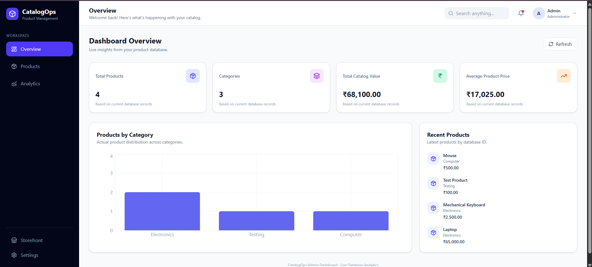
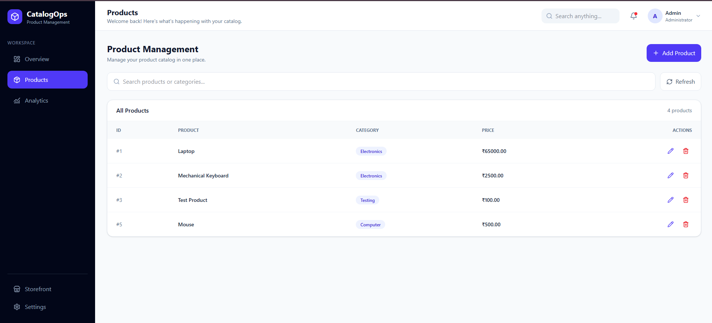
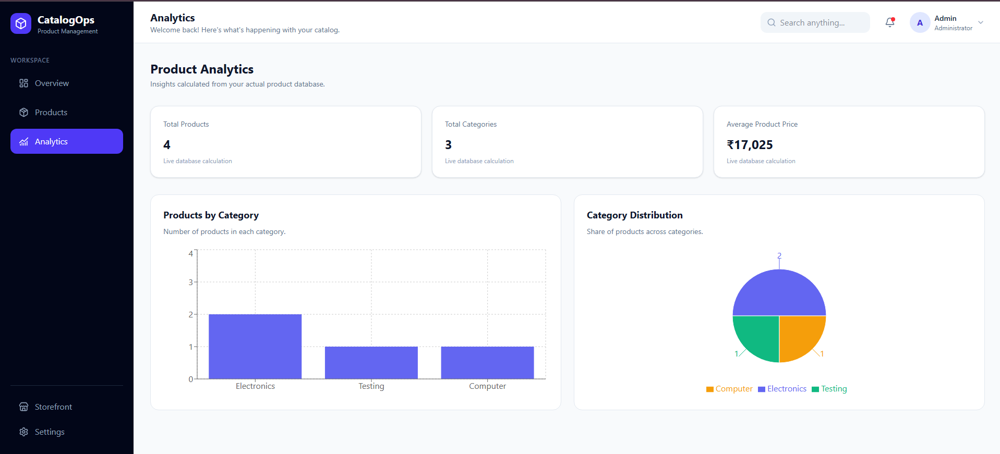
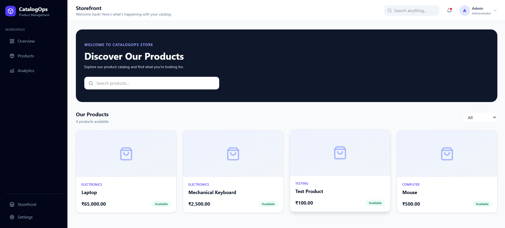
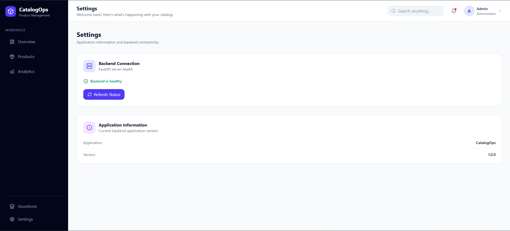
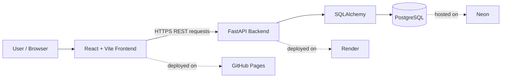

<div align="center">

# 📦 CatalogOps

### A full-stack product catalog management platform

REST API + dashboard-style frontend for managing products, exploring live catalog analytics, and browsing a searchable storefront.

<p>
  
  
  
  
  
</p>
<p>
  
  
  
  
</p>

<p>
  <a href="https://abhiabhishekoffl.github.io/catalogOps/"><strong>🚀 Live Application</strong></a>
  &nbsp;·&nbsp;
  <a href="https://catalogops-api.onrender.com/docs"><strong>📖 API Documentation</strong></a>
  &nbsp;·&nbsp;
  <a href="https://catalogops-api.onrender.com/health"><strong>💚 API Health</strong></a>
</p>



</div>

---

## 📑 Contents

- [Project Overview](#-project-overview)
- [Screenshots](#-screenshots)
- [Live Deployment](#-live-deployment)
- [Features](#-features)
- [Architecture](#-architecture)
- [Technology Stack](#-technology-stack)
- [Repository Structure](#-repository-structure)
- [Getting Started](#-getting-started)
- [Docker Setup](#-docker-setup)
- [API Reference](#-api-reference)
- [Testing](#-testing)
- [CI/CD Workflows](#-cicd-workflows)
- [Kubernetes Manifests](#-kubernetes-manifests)
- [Security and Production Notes](#-security-and-production-notes)
- [Roadmap](#-roadmap)
- [Contributing](#-contributing)
- [License](#-license)

---

## 🧭 Project Overview

CatalogOps provides a central interface for maintaining a product catalog. The React frontend communicates with a FastAPI backend, while SQLAlchemy persists product records in PostgreSQL.

The application currently supports product details consisting of:

| Field | Description |
|---|---|
| `id` | Database-generated product identifier |
| `name` | Product name |
| `category` | Product category |
| `price` | Product price |

The dashboard and analytics views calculate their figures from the product database rather than relying on hard-coded chart data.

---

## 🖼️ Screenshots

### Dashboard Overview
Live KPIs (total products, categories, catalog value, average price), a category chart, and recently added products.

<p align="center">
  
</p>

### Product Management
Search, create, edit, and delete products from a single table.

<p align="center">
  
</p>

### Analytics
Backend-calculated metrics with a category bar chart and a distribution pie chart.

<p align="center">
  
</p>

### Storefront
A customer-facing catalog with search and category filtering, priced in Indian Rupees.

<p align="center">
  
</p>

### Settings
Backend connectivity check and application version information.

<p align="center">
  
</p>

---

## 🌐 Live Deployment

| Component | URL / Platform |
|---|---|
| 🖥️ Frontend | [CatalogOps on GitHub Pages](https://abhiabhishekoffl.github.io/catalogOps/) |
| ⚙️ Backend API | [FastAPI service on Render](https://catalogops-api.onrender.com) |
| 📘 Interactive API docs | [Swagger UI](https://catalogops-api.onrender.com/docs) |
| ❤️ Health endpoint | [`/health`](https://catalogops-api.onrender.com/health) |
| 🗄️ Database | PostgreSQL on Neon |

> [!NOTE]
> The repository also contains an optional AWS EC2 deployment workflow for versioned Docker releases. See [CI/CD Workflows](#-cicd-workflows); the presence of that workflow does not mean the live Render deployment is running on EC2.

---

## ✨ Features

<table>
<tr>
<td width="50%" valign="top">

### 🛍️ Product management
- Create products with a name, category, and price
- View the complete product list
- Retrieve an individual product by ID through the API
- Edit existing product details
- Delete products with a confirmation prompt
- Search products by name or category

### 📊 Dashboard
- Total product count
- Number of distinct categories
- Total catalog value
- Average product price
- Product count by category
- Recently added products
- Refreshable, database-backed summary data

</td>
<td width="50%" valign="top">

### 📈 Analytics
- Category-wise product count bar chart
- Category distribution pie chart
- Summary metrics calculated by the backend

### 🏪 Storefront
- Browse catalog products
- Search by product name or category
- Filter products by category
- Prices displayed in Indian Rupee formatting

### 🔧 Application and API operations
- Backend health endpoint
- Separate liveness and readiness endpoints
- Application version endpoint
- CORS configuration for local development and configured frontend origins

</td>
</tr>
</table>

---

## 🏗️ Architecture



### Request flow

1. A user interacts with the React interface.
2. The frontend API service sends HTTP requests to the configured FastAPI base URL.
3. FastAPI validates request data using Pydantic schemas.
4. SQLAlchemy queries or updates PostgreSQL.
5. The API returns JSON, which the frontend uses to refresh the interface.

---

## 🧰 Technology Stack

| Layer | Technologies |
|---|---|
| **Frontend** | React 19, Vite 8, Tailwind CSS 4 |
| **Charts and icons** | Recharts, Lucide React |
| **Backend** | Python 3.12, FastAPI, Uvicorn |
| **Data validation** | Pydantic |
| **ORM** | SQLAlchemy |
| **Database** | PostgreSQL |
| **Testing** | Pytest, FastAPI TestClient, HTTPX |
| **Containers** | Docker, Docker Compose |
| **CI/CD** | GitHub Actions |
| **Hosting** | GitHub Pages, Render, Neon |
| **Optional deployment tooling** | AWS Systems Manager, EC2, Docker Hub |
| **Orchestration manifests** | Kubernetes YAML |

---

## 📂 Repository Structure

```text
catalogOps/
├── .github/
│   └── workflows/
│       ├── ci.yml                 # Backend test workflow
│       ├── cd.yml                 # Optional versioned EC2 deployment
│       └── deploy.yml             # Frontend GitHub Pages deployment
├── app/
│   ├── database/
│   │   ├── database.py            # SQLAlchemy engine and DB sessions
│   │   └── testing_database.py    # Test database configuration
│   ├── models/
│   │   └── product.py             # Product ORM model
│   ├── schemas/
│   │   └── product.py             # Pydantic request/response schemas
│   └── main.py                    # FastAPI application and routes
├── docs/
│   └── screenshots/               # README screenshots
├── frontend/
│   ├── public/
│   └── src/
│       ├── components/
│       ├── pages/
│       ├── services/
│       │   └── api.js             # Frontend API client
│       ├── App.jsx
│       └── main.jsx
├── k8s/                           # Kubernetes deployment and DB manifests
├── tests/
│   └── test_products.py
├── Dockerfile
├── compose.yml
├── requirements.txt
├── requirements-dev.txt
└── README.md
```

---

## 🚀 Getting Started

### Prerequisites

- Python 3.12
- Node.js 24 and npm
- PostgreSQL 18 (or a compatible PostgreSQL instance)
- Git

Docker Desktop or Docker Engine is optional if you prefer the containerized setup.

### 1. Clone the repository

```bash
git clone https://github.com/abhiabhishekoffl/catalogOps.git
cd catalogOps
```

### 2. Backend setup

Create and activate a virtual environment.

<details open>
<summary><b>Windows PowerShell</b></summary>

```powershell
python -m venv venv
.\venv\Scripts\Activate.ps1
```

</details>

<details>
<summary><b>macOS / Linux</b></summary>

```bash
python3 -m venv venv
source venv/bin/activate
```

</details>

Install dependencies:

```bash
pip install -r requirements.txt
```

Create a local `.env` file in the repository root. Configure either `DATABASE_URL` or the individual PostgreSQL variables shown below.

```dotenv
DB_HOST=localhost
DB_PORT=5432
DB_NAME=catalogops
DB_USER=postgres
DB_PASSWORD=replace_with_your_local_password
CATALOGOPS_VERSION=local
FRONTEND_ORIGINS=http://localhost:5173
```

Create the database named `catalogops` in PostgreSQL, then start the API:

```bash
uvicorn app.main:app --reload --host 0.0.0.0 --port 8001
```

The local API will be available at:

| Resource | URL |
|---|---|
| API root | `http://localhost:8001/` |
| Swagger UI | `http://localhost:8001/docs` |
| Health | `http://localhost:8001/health` |

### 3. Frontend setup

Open a second terminal:

```bash
cd frontend
npm ci
```

Create `frontend/.env.local`:

```dotenv
VITE_API_URL=http://localhost:8001
```

Start the Vite development server:

```bash
npm run dev
```

Open the local frontend URL printed by Vite (normally `http://localhost:5173`).

For a production build:

```bash
npm run build
```

The generated static site is written to `frontend/dist/`.

### Environment Variables

| Variable | Used by | Purpose |
|---|---|---|
| `DATABASE_URL` | Backend | Optional complete PostgreSQL connection URL; takes precedence over individual DB settings |
| `DB_HOST` | Backend | PostgreSQL hostname; defaults to `localhost` |
| `DB_PORT` | Backend | PostgreSQL port; defaults to `5432` |
| `DB_NAME` | Backend | Database name; defaults to `catalogops` |
| `DB_USER` | Backend | Database username; defaults to `postgres` |
| `DB_PASSWORD` | Backend / Compose | Database password |
| `CATALOGOPS_VERSION` | Backend / Compose | Version returned by `/version` |
| `FRONTEND_ORIGINS` | Backend | Comma-separated additional allowed browser origins |
| `VITE_API_URL` | Frontend build | Base URL used by the browser to call the backend |

> [!WARNING]
> Vite variables prefixed with `VITE_` are embedded into the client-side build. Never put passwords, private keys, or other secrets in them. Keep `.env` files out of version control.

---

## 🐳 Docker Setup

The repository includes a Dockerfile that runs the API as a non-root `catalogops` user and a Compose definition for the API and PostgreSQL.

Create a root `.env` file before starting Compose:

```dotenv
CATALOGOPS_VERSION=1.0.0
DB_PASSWORD=replace_with_a_strong_local_password
```

Build and start the services:

```bash
docker compose -f compose.yml up -d --build
```

Check service status and logs:

```bash
docker compose -f compose.yml ps
docker compose -f compose.yml logs -f catalogops
```

Check the API:

```bash
curl http://localhost:8000/health
```

Stop the services:

```bash
docker compose -f compose.yml down
```

To stop the services and remove the named database volume as well (this deletes the local database data):

```bash
docker compose -f compose.yml down -v
```

Compose maps the API to port `8000` and keeps PostgreSQL on the internal Compose network. The database data is stored in the `postgres_data` named volume.

---

## 🔌 API Reference

Product and dashboard routes live under `/api/v1`; health, version, and root routes are served from the application root.

| Method | Endpoint | Description |
|---|---|---|
| `GET` | `/` | API welcome message |
| `GET` | `/health` | Basic application health |
| `GET` | `/health/live` | Liveness check |
| `GET` | `/health/ready` | Database-backed readiness check |
| `GET` | `/version` | Application name and configured version |
| `GET` | `/api/v1/products` | List all products |
| `GET` | `/api/v1/products/{product_id}` | Get one product |
| `POST` | `/api/v1/products` | Create a product |
| `PUT` | `/api/v1/products/{product_id}` | Replace product details |
| `DELETE` | `/api/v1/products/{product_id}` | Delete a product |
| `GET` | `/api/v1/dashboard/summary` | Dashboard and category summary |

<details>
<summary><b>Example: Create a product</b></summary>

```bash
curl -X POST "http://localhost:8001/api/v1/products" \
  -H "Content-Type: application/json" \
  -d '{
    "name": "Mechanical Keyboard",
    "category": "Accessories",
    "price": 2499.00
  }'
```

Example response:

```json
{
  "id": 1,
  "name": "Mechanical Keyboard",
  "category": "Accessories",
  "price": 2499.0
}
```

</details>

<details>
<summary><b>Example: List products</b></summary>

```bash
curl "http://localhost:8001/api/v1/products"
```

</details>

<details>
<summary><b>Example: Update a product</b></summary>

```bash
curl -X PUT "http://localhost:8001/api/v1/products/1" \
  -H "Content-Type: application/json" \
  -d '{
    "name": "Mechanical Keyboard",
    "category": "Accessories",
    "price": 2699.00
  }'
```

</details>

<details>
<summary><b>Example: Delete a product</b></summary>

```bash
curl -X DELETE "http://localhost:8001/api/v1/products/1"
```

</details>

Interactive request and response schemas are available in Swagger UI at `/docs`.

---

## 🧪 Testing

The backend test suite uses Pytest and FastAPI's `TestClient`. Tests use the separate test database configuration in `app/database/testing_database.py`.

Install the development dependencies listed in `requirements-dev.txt`:

```bash
pip install -r requirements-dev.txt
```

> [!NOTE]
> The supplied `requirements-dev.txt` is currently encoded as UTF-16 LE. If your package installer reports an encoding or parsing error, convert that file to UTF-8 and retry. This is a file-format issue in the current repository snapshot, not a Python dependency requirement.

The test database configuration currently connects to `localhost:5432` as `postgres` and uses the `DB_PASSWORD` value loaded from the root `.env` file. Create a separate PostgreSQL database named `catalogops_test` and set `DB_PASSWORD` before running tests. Then run:

```bash
pytest -v
```

The checked-in tests cover the root route, product listing, product retrieval, product creation, product updates, product deletion, not-found behavior, health, version, liveness, and readiness.

> [!CAUTION]
> Run tests only against the dedicated test database. The test fixture deletes product rows before and after each test.

---

## ⚙️ CI/CD Workflows

The repository contains three GitHub Actions workflows:

| Workflow | File | Purpose |
|---|---|---|
| ✅ Continuous Integration | `ci.yml` | Backend tests on every push and pull request |
| 📦 Backend release (optional) | `cd.yml` | Versioned Docker images and EC2 deployment |
| 🌍 Frontend deployment | `deploy.yml` | Build and publish the frontend to GitHub Pages |

<details>
<summary><b>Continuous Integration — <code>ci.yml</code></b></summary>

- Runs on pushes to `main`, version tags matching `v*`, and pull requests targeting `main`.
- Starts a PostgreSQL 18 service for the test job.
- Installs Python dependencies and runs `pytest`.
- For version tags, writes and uploads a release-version artifact.

</details>

<details>
<summary><b>Optional backend release and EC2 deployment — <code>cd.yml</code></b></summary>

- Runs after a successful CI push workflow when a version release artifact is available, or through manual workflow dispatch.
- Builds and publishes versioned and `latest` Docker images to Docker Hub for tagged releases.
- Uses GitHub Actions OIDC to obtain AWS credentials and AWS Systems Manager to run deployment commands on the configured EC2 instance.
- Checks the deployed API health and attempts to restore the previous image version if the health check fails.

> [!IMPORTANT]
> This workflow requires correctly configured GitHub repository secrets, AWS IAM/OIDC trust, an SSM-managed EC2 instance, and Docker Hub credentials. Do not run it until those prerequisites and the target infrastructure have been reviewed.

</details>

<details>
<summary><b>Frontend deployment — <code>deploy.yml</code></b></summary>

- Runs on pushes to `main` or manual dispatch.
- Installs frontend dependencies with `npm ci`.
- Builds the Vite application using the configured production API URL.
- Publishes `frontend/dist` to GitHub Pages.

</details>

---

## ☸️ Kubernetes Manifests

The `k8s/` directory contains example manifests for a CatalogOps Deployment, PostgreSQL Deployment, PostgreSQL Service, and PersistentVolumeClaim. The repository also includes a PodDisruptionBudget and patch files for probe and metrics-server configuration.

> [!WARNING]
> These files are **deployment examples, not a verified one-command production Kubernetes installation**. Review and adapt them before applying.

- Ensure the application and PostgreSQL deployments reference the same Kubernetes Secret name and key. The checked-in manifests currently use different secret names.
- The CatalogOps Deployment currently points its readiness and liveness probes at `/health`; consider using `/health/ready` for readiness and `/health/live` for liveness.
- The PVC uses the `hostpath` storage class, which is environment-specific and may not exist in your cluster.
- Configure storage, resource requests/limits, secrets, image versions, networking, and ingress for your target cluster.

Do not commit real Kubernetes Secret values to the repository.

---

## 🔐 Security and Production Notes

CatalogOps is a portfolio and learning project. Before using it for a real business catalog, consider the following:

- **Authentication and authorization:** product CRUD endpoints currently do not implement user authentication or role-based access control.
- **Input and data constraints:** add explicit validation and database constraints for business-specific requirements.
- **Database migrations:** introduce a migration workflow (for example, Alembic) rather than relying on application startup table creation for schema evolution.
- **Observability:** add structured application logs, metrics, tracing, and alerting appropriate to the deployment.
- **Transport and secrets:** use HTTPS, managed secrets, least-privilege credentials, and restricted database network access.
- **Backups:** configure and regularly test database backup and restore procedures.

Never publish `.env` files, database credentials, access tokens, private keys, or cloud secrets.

---

## 🗺️ Roadmap

- [ ] Authentication and role-based access control
- [ ] Product pagination, sorting, and advanced filtering
- [ ] Stronger schema and database-level validation
- [ ] Alembic database migrations
- [ ] Automated frontend tests and end-to-end tests
- [ ] Structured logging, metrics, and distributed tracing
- [ ] More granular readiness checks and deployment observability

---

## 🤝 Contributing

Contributions and suggestions are welcome.

1. Fork the repository.
2. Create a feature branch.
3. Make focused changes and add or update tests.
4. Run the test suite and frontend build.
5. Open a pull request describing the change.

---

## 📄 License

No `LICENSE` file is currently included in this repository. Until a license is added, the project should not be assumed to be available for reuse, redistribution, or modification under an open-source license.

---

<div align="center">

Built with ❤️ using FastAPI, React, and PostgreSQL

**Author:** [Abhishek Kumar](https://github.com/abhiabhishekoffl)

</div>